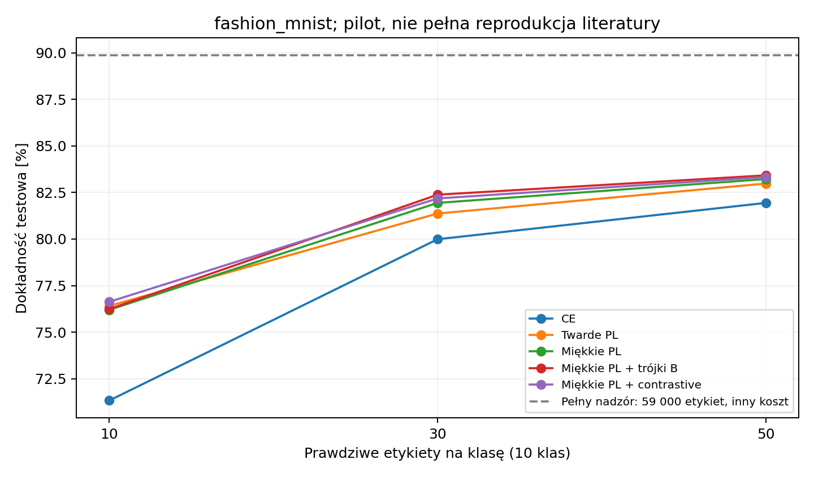

# Co rzeczywiście zostało wykonane

Migawka: **20 października 2026**, 74 ukończone treningi:
55 głównych CIFAR-10, 3 wcześniejsze supervised i 16 Fashion-MNIST.
Nie liczymy testów syntetycznych, benchmarków ani niewykonanych manifestów.

## CIFAR-10

| Metoda | Etykiety treningowe | Test [%] |
|---|---:|---:|
| CE, 20 epok | 500 | 49,25 |
| Twarde pseudoetykiety | 500 | 58,25 |
| Miękkie cele i wagi, 20 epok | 500 | 60,12 |
| Miękkie + trójki B | 500 | 60,96 |
| Miękkie + contrastive/pseudo | 500 | 60,55 |
| Miękkie cele i wagi, 80 epok | 500 | 65,34 |
| Pełny nadzór | 49 000 | 79,75 |

Trzy seedy: CE 48,84 ± 0,37%; hard PL 57,39 ± 0,80%; soft PL 59,27 ± 0,94%
(średnia ± SD). Większość rozszerzeń ma tylko seed0. Dłuższy trening i pełny
nadzór mają inny koszt; pełny nadzór miał również wcześniejszy protokół widoków.
AL i liczne dodatki nie dały przekonującej przewagi nad właściwymi kontrolami.
Trójki/contrastive zmieniały część miar geometrii silniej niż samą klasyfikację.

Pełne wyjaśnienia: [raport PDF](../reports/Raport_badan_CIFAR10_2026-10-20.pdf).

## Fashion-MNIST

Dokładność testowa, seed0. Wszystkie małe budżety: 2000 kroków i ten sam
encoder 38 378 parametrów. Liniowy probe i geometria oceniane na walidacji.

| Metoda | 10 etykiet/klasę | 30/klasę | 50/klasę |
|---|---:|---:|---:|
| CE | 71,33 | 79,99 | 81,94 |
| Twarde PL | 76,41 | 81,37 | 82,98 |
| Miękkie PL | 76,20 | 81,94 | 83,22 |
| Miękkie + trójki | 76,24 | 82,38 | 83,42 |
| Miękkie + contrastive | 76,63 | 82,18 | 83,33 |

Pełny nadzór: 59 000 etykiet, 9220 kroków, **89,87%** testu. Jest odniesieniem,
nie ścisłym górnym ograniczeniem. Największy zysk SSL jest przy najmniejszym
budżecie: +5,30 p.p. wobec CE. Dodatki do pseudoetykiet dają niewielkie zmiany;
jeden seed nie rozstrzyga o ich powtarzalności.

## Co jest w migawce?

W `results/`: pełne porównania JSON/CSV, konfiguracje, metryki, podziały i historie
każdego ukończonego runu, metryki reprezentacji i wybrane wykresy.
`results/manifest.json` zawiera sumy kontrolne. `results/environment.json`
opisuje środowisko eksportu; nie dowodzi identycznych wersji w każdym dawnym runie
(te informacje są także w jego metrykach).

Checkpointy i macierze embeddingów pozostają poza Gitem. Dlatego z samego klonu
można analizować zapisane wyniki, ale do ponownego obliczenia audytów trzeba
odtworzyć trening lub otrzymać osobne lokalne archiwum z wagami.
